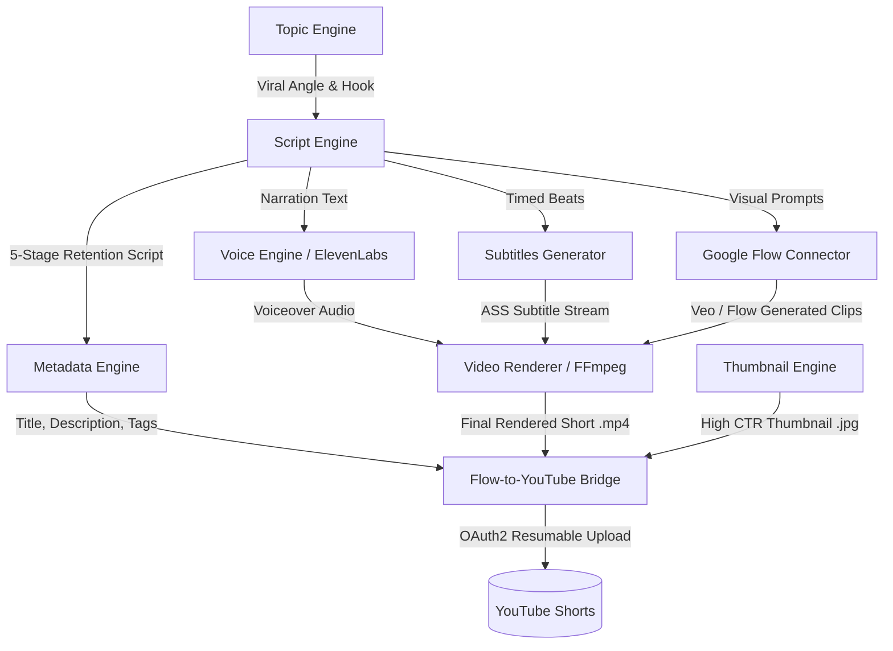

# 🚀 Autonomous YouTube Shorts & Stickman Video Automation Suite

An end-to-end, production-grade automation system that turns viral topics into fully produced, rendered, and uploaded **YouTube Shorts**. Features automated topic research, 5-stage retention scriptwriting, high-CTR thumbnail generation, stylized subtitle burning, dynamic video rendering with Ken Burns animation, **Google Flow video generation integration**, and **automated YouTube API v3 publishing**.

Includes bundled agent skills for **Directing Stickman Videos** and **Cartoon Audio Shorts**.

---

## 🌟 Key Features

- 🧠 **Curiosity & Paradox Topic Engine**: Generates viral hooks and high-retention concepts using Gemini AI or the built-in viral anomaly library.
- 📜 **5-Stage Heartbeat Script Engine**: Structures scripts according to YouTube retention mechanics:
  1. *Golden Hook* (0–3s paradox trigger)
  2. *Disrupting Assumptions* (3–12s cognitive clash)
  3. *Unveiling Insider Secrets* (12–28s escalation)
  4. *Ultimate Truth Revelation* (28–42s payoff)
  5. *Elevation & Discussion CTA* (42–50s comments booster)
- 🎙️ **Multi-Engine Voiceover**: High-retention acoustic pacing using **ElevenLabs** (Adam, Brian, George) with automatic fallback to Windows Speech / Edge-TTS.
- 🎨 **CTR Thumbnail Engine**: Automated 9:16 & 16:9 thumbnails with dual-text pop (Yellow/Cyan + White), thick black strokes, curiosity badges, and contrast gradient vignettes.
- 📝 **Stylized Subtitle Burning**: Generates `.ass` and `.srt` subtitles with header banners and karaoke-style dialogue highlights burned directly into frames via FFmpeg.
- 🎥 **Ken Burns Video Renderer**: Dynamic zoom/pan effects, frame composition, and ducked background audio (-16dB under voiceover).
- ⚡ **Google Flow Video Generation Bridge (`connect_flow_and_upload.py`)**: Seamless bridge linking Google Flow / Gemini Veo / Vertex AI video generation scripts directly to the automated YouTube upload pipeline.
- 📤 **YouTube Data API v3 Automation**: Automated OAuth2 publishing, custom thumbnail setting, tags, playlist routing, and scheduled publication.
- 🧰 **Bundled Skills Suite**: Includes full production rules, references, and assets for `directing-stickman-videos`, `cartoon-audio-short`, and `stickman-video-director`.

---

## 🏗️ System Architecture



---

## 📂 Project Structure

```
yt-shorts-automation/
├── core/
│   ├── topic_engine.py         # AI & algorithmic topic/hook discovery
│   ├── script_engine.py        # 5-stage narrative retention scriptwriting
│   ├── metadata_engine.py     # SEO title, description, tags, pinned comment
│   ├── voice_engine.py         # ElevenLabs & local voiceover synthesis
│   ├── thumbnail_engine.py     # High-CTR 9:16 thumbnail generator
│   ├── subtitles_generator.py  # Formatted ASS/SRT subtitle generator
│   └── video_renderer.py       # FFmpeg & OpenCV Ken Burns video assembler
│
├── integrations/
│   ├── google_flow_connector.py  # Google Flow & Gemini Veo video generator connector
│   ├── youtube_uploader.py       # YouTube Data API v3 OAuth2 uploader
│   └── flow_to_youtube_bridge.py # Direct bridge connecting Flow video gen to YT upload
│
├── skills/                     # Bundled agent skills & references
│   ├── directing-stickman-videos/ # Full stickman directing & autopilot engine
│   ├── cartoon-audio-short/       # 2D cartoon audio shorts kit & engine
│   └── stickman-video-director/   # Multi-language director suite
│
├── templates/                  # Subtitle and storyboard templates
├── output/                     # Generated videos, thumbnails, and manifests
├── assets/                     # Audio BGM, SFX, and custom stickers
│
├── run_pipeline.py             # Master CLI pipeline runner
├── connect_flow_and_upload.py  # Standalone Google Flow to YouTube upload bridge
├── config.py                   # Central settings & path resolution
├── requirements.txt            # Python dependencies
├── .env.example                # Environment variables template
└── README.md                   # Documentation
```

---

## 🚀 Quickstart Guide

### 1. Prerequisites
- **Python 3.10+**
- **FFmpeg**: Ensure FFmpeg is installed and accessible in your system `PATH` (or specify `FFMPEG_PATH` in `.env`).

### 2. Installation
```bash
git clone https://github.com/your-username/yt-shorts-automation.git
cd yt-shorts-automation
pip install -r requirements.txt
```

### 3. Configure API Credentials
Copy `.env.example` to `.env`:
```bash
cp .env.example .env
```
Edit `.env` and provide your credentials:
```env
GEMINI_API_KEY=your_gemini_api_key
ELEVENLABS_API_KEY=your_elevenlabs_api_key
GOOGLE_CLOUD_PROJECT=your_project_id
GOOGLE_FLOW_ENDPOINT=https://your-flow-endpoint.com/generate
```

---

## 💻 Usage

### 1. Autonomous End-to-End Shorts Generation
Generate a full short from scratch (topic, script, voiceover, subtitles, thumbnail, and final video):
```bash
python run_pipeline.py --topic "auto" --language "hinglish"
```

### 2. Generate on a Specific Topic
```bash
python run_pipeline.py --topic "The Man Who Sold the Eiffel Tower Twice" --language "english"
```

### 3. Generate and Automatically Upload to YouTube
```bash
python run_pipeline.py --topic "auto" --upload --privacy "public"
```

---

## ⚡ Connecting Google Flow to YouTube Upload

The dedicated bridge file **`connect_flow_and_upload.py`** connects video renders generated by Google Flow, Gemini Veo, or external video scripts directly into the YouTube upload pipeline.

### Option A: Publish a Single Rendered Video
```bash
python connect_flow_and_upload.py --video "output/flow_render.mp4" --manifest "output/flow_manifest.json" --privacy "public"
```

### Option B: Daemon Watcher Mode (Automatic Intake)
Run the bridge in background daemon mode. Whenever Google Flow finishes rendering a video into the `output/` directory, the bridge automatically pairs it with its thumbnail and metadata, uploads it to YouTube, and moves it to an archive:
```bash
python connect_flow_and_upload.py --watch
```

---

## 🔑 YouTube Data API v3 Setup

1. Go to the [Google Cloud Console](https://console.cloud.google.com/).
2. Create a project and enable the **YouTube Data API v3**.
3. Navigate to **APIs & Services > Credentials**.
4. Create an **OAuth 2.0 Client ID** with Application Type set to **Desktop app**.
5. Download the JSON credentials file and save it in the root directory as **`client_secrets.json`**.
6. On the first upload run, a browser window will open asking you to authenticate your YouTube channel. A `token.pickle` file will be generated automatically for all future headless uploads.

---

## 🎭 Included Agent Skills

This repository bundles the exact skills configured for automated video creation:

- **`skills/directing-stickman-videos`**: Complete directing rules, 5-stage emotional heartbeat engine, Style 1–5 prompts, voice continuity profiles, and QA rubrics.
- **`skills/cartoon-audio-short`**: 2D bean-head character animation engine with 50% ducked SFX and music bed integration.
- **`skills/stickman-video-director`**: Multi-language director suite with baseline scenarios and evaluation rubrics.

---

## 📄 License

MIT License. Free for commercial and personal YouTube automation workflows.
